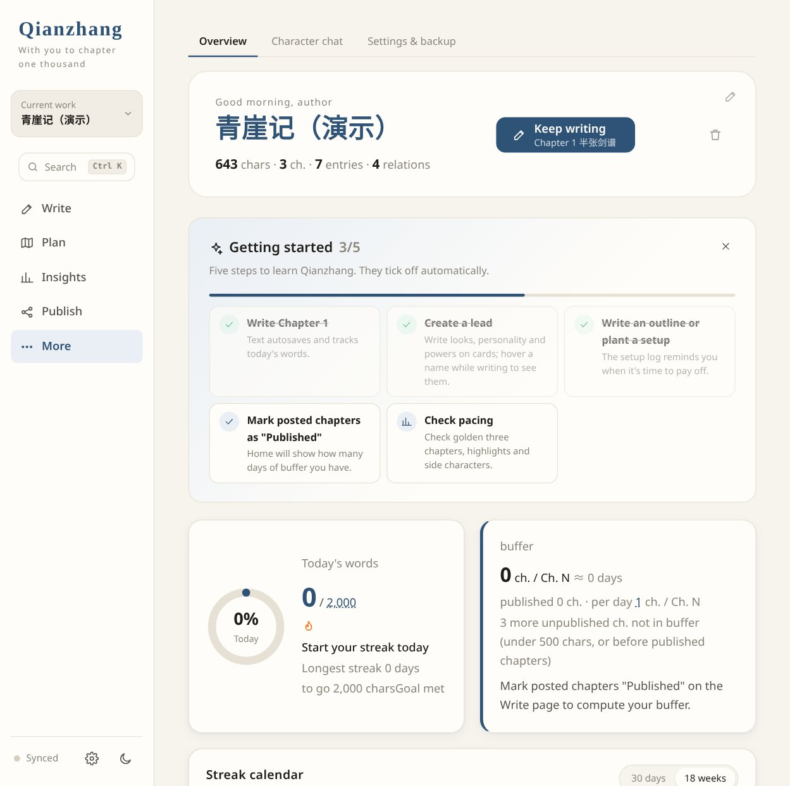
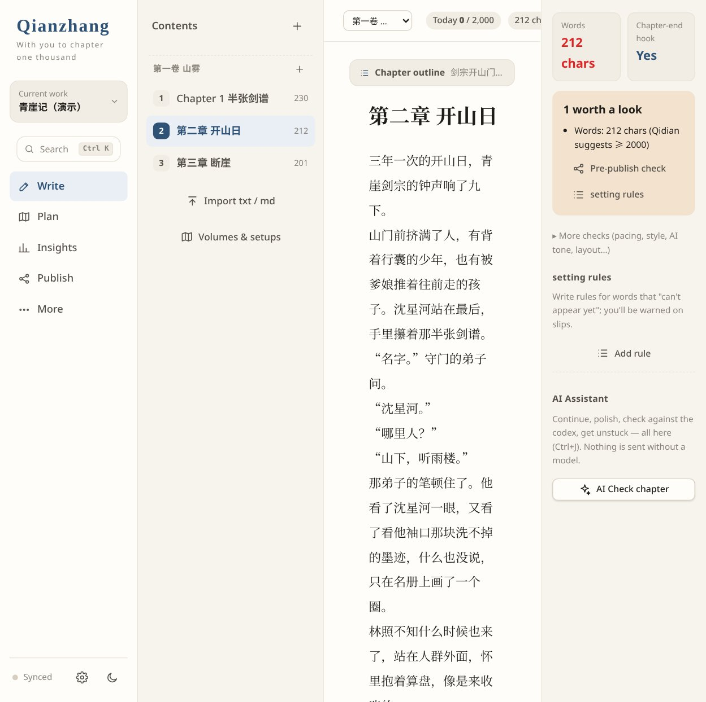

# Qianzhang · Local Novel Writing Workspace

English · [简体中文](#简体中文)

## English

**Write all the way to chapter one thousand.** Qianzhang (千章, "a thousand chapters") is a local writing tool for authors who publish Chinese web novels in daily installments. Work files stay on your own computer, and every local feature works without AI. When you choose to use a remote AI service, the relevant manuscript and setting context is sent to your selected provider.

## Keep a long story coherent

- **Foreshadowing you can follow through:** record a thread and its planned payoff chapter; see due and overdue reminders.
- **Character and setting checks:** keep character cards and aliases together, review likely name mistakes and appearances after a recorded death, and jump to the flagged text. Check results are prompts for your review.
- **Your manuscripts stay local:** write and use the local tools without an AI account. Connect an AI provider only when you want the optional editor, co-writer or character chat.

## Download for Windows

**[Download Qianzhang for Windows x64 (portable ZIP) from Releases](https://github.com/lalala-git/qianzhang-writer/releases/latest)** — the release page also lists SHA-256 checksums.

1. Extract the entire ZIP into a folder where you can save files.
2. Double-click `Qianzhang.exe` (if Windows SmartScreen stops it, see [below](#windows-smartscreen-and-security-software)). Edge or Chrome is recommended for the standalone app window. You do not need to install Node.js or configure an API key to use the local writing tools.
3. Choose **新建作品 (New work)** and start writing. The app starts in Chinese; switch to English in **设置 (Settings) → 界面语言 · Language**.

Keep the `data` folder beside the exe: it contains your works, backups and app settings. Move the whole folder when moving computers; when upgrading, close Qianzhang and replace the exe while keeping `data`. macOS, Linux and developers can [run from source](#install-and-run-from-source).

Author: **lalala.gpt** · AI development collaborator: **[Grok (xAI)](https://x.ai/) · Grok Bot 水滴💧** ([GitHub app](https://github.com/apps/grok-by-xai)).

> Developed with Grok by xAI. Grok assisted with the development of this project.

Additional contributor: **[Codex (OpenAI)](https://github.com/codex)** — documentation, earlier English localization, and release preparation.

> For why each feature exists, see [docs/pain-points.md](docs/pain-points.md) (in Chinese).





## Windows SmartScreen and security software

`Qianzhang.exe` is **not code-signed**. On first launch Windows SmartScreen may show "Windows protected your PC": click **More info → Run anyway**. Some security software also blocks or quarantines unsigned programs; allow it there, or run from source instead. Only download from this repository's Releases page and compare the SHA-256 checksum.

## Platforms and what has been verified

- **Windows x64**: portable exe, built and launched on a real Windows PC.
- **macOS and Linux**: no packaged app; [run from source](#install-and-run-from-source) with Node.js. The CI tests run on GitHub's Linux, macOS and Windows runners, and the `source-packages` workflow builds macOS / Linux source packages with a start script (`start.sh`; `Qianzhang.command` on macOS) after the tests pass. These are cloud runners only: Qianzhang has **not been tested on real macOS or Linux desktop hardware**.
- **AI features**: tested only against simulated OpenAI-compatible responses in the automated tests, **not verified against a real AI service**. Provider-specific behaviour (DeepSeek, OpenAI, Ollama…) may differ; please report problems.

## What it does

**Keep the daily rhythm**

- **Always know where today stands**: a daily-goal ring, streak days, an 18-week / last-30-days calendar, word and chapter milestones, and a warning before a missed day breaks your streak. A chapter buffer and planned publication dates show how long your stock lasts and when the next update is due.
- **Fewer interruptions while you write**: every delete can be undone (chapters and works both have a trash), and how often reminders appear is adjustable in Settings.

**Keep a long story straight**

- **Outline and foreshadowing**: volumes and per-chapter outlines at a glance. Write down a thread together with the chapter where it should pay off, and Qianzhang reminds you when it is due or overdue, so a promise made in chapter 12 is not forgotten by chapter 300.
- **Characters and settings**: cards for characters, places and rules, a relationship graph, and chatting with your own characters when you want to hear how they would talk.
- **Canon, collected for you**: after each chapter, new characters, new places and state changes (injured, dead…) are gathered so you can add them to your settings in one click. A character recorded as dead who shows up again is flagged; if the text says someone died but their card does not record it yet, later appearances get a lower-severity warning.

**Catch slips before your readers do**

- **A check-up after every chapter**: typos, likely misspelled names, aliases and nicknames (variant characters, full-width letters, stray spaces inside names; fix all chapters in one click, undoable), sensitive words, crutch phrases, frequent repeats, AI-sounding prose (stock phrases like 「眼中闪过一丝」), mobile layout, overlong sentences, point-of-view slips, chapter-end hooks and more. Click any hit to jump to it in the text. The results are prompts for you to review, not verdicts.

**Quiet, local, yours**

- **Closing the window ends the program (Windows)**: close the standalone window and Qianzhang quits. If it had to open in your default browser, a tray icon and a "Quit Qianzhang" button in the sidebar save your work and quit.
- **Chinese by default, English available**: new installs start in Chinese. Switch to English in 设置 (Settings) → 界面语言 · Language; an existing language choice is preserved. The screenshots in this README show the English interface. AI replies follow the selected interface language.
- **AI (optional)**: connect an OpenAI-compatible endpoint that allows browser cross-origin requests (CORS), such as DeepSeek, OpenAI or a local Ollama, to get an AI editor, writer's-block helper, continue/polish, a co-writer and character chat. Requests go directly from your browser to the configured endpoint. Depending on the feature, they may include selected manuscript text, character profiles, relationships, world rules, recent chapters and conversation history. The endpoint and model name are kept in the browser; the API key is encrypted by the local server (see below) and sent to the configured endpoint with each request. Usage limits and charges depend on the selected provider.
- **A quiet nudge when a new version is out (1.1.0)**: shortly after start-up, Qianzhang asks GitHub once whether a newer release exists. If so, a small note appears in the sidebar; click it to open the release page in your browser. It never downloads anything or replaces the exe by itself, it stays silent when you are offline, and one switch in Settings turns it off. The request carries none of your writing or personal data.

**Privacy and AI co-writing:** The API key is never kept in browser storage. The local server encrypts it into `data/app/ai-key.json`: on Windows with DPAPI, tied to your Windows account; elsewhere with AES-256-GCM using a key derived from this machine. A copied, synced or shared data folder therefore does not reveal the key, although this does not protect against malware running under your account. Keys that older versions left in browser storage are moved there automatically and then deleted from the browser. The co-writer starts **off** every time; the first time you turn it on with a model connected, it explains what will be sent and where. While it is on, pauses in typing send approximately the latest 800 characters, and the write page shows a persistent **Co-writer on · Turn off** indicator that switches it off in one click. **Export backup omits API keys by default**; tick the option to include the model connection and key (in plaintext). Backups still contain manuscript, world-building and chat data, and unknown fields from imported work files may be retained, so review backups before sharing.

## Install and run from source

Running from source requires [Node.js](https://nodejs.org/) 18 or newer, with no npm dependencies or frontend build. The following commands apply to Windows, macOS and Linux; Windows single-file packaging has separate requirements below:

```
git clone https://github.com/lalala-git/qianzhang-writer.git
cd qianzhang-writer
node server/server.js .
```

Then open <http://127.0.0.1:7801/> in your browser. To use another port: `node server/server.js . --port 8080` (or set `PORT=8080`).

**Keep that terminal window open while you write**; press `Ctrl+C` in it to quit. The server listens only on 127.0.0.1, so other devices on your network cannot reach it.

On first launch the shelf is empty: click 新建作品 (New work). The source server creates the works directory only when a work is first saved. Planned publication dates provide local reminders; the app does not upload chapters to publishing platforms. Copy or export from the Publish page, then publish on your chosen platform yourself.

## Where your books are stored

- Works: `data/projects/<work>.json` inside the repository, saved automatically (the folder is created on the first save).
- Automatic backups: the previous version is kept in `data/projects/.backup/` on every save (last 10), plus one per day (last 14 days).
- Deleted works go to `data/projects/.trash/` first and can be restored from Settings → Trash.
- The browser also attempts to keep a local copy for recovery while the local server is briefly unreachable. Check the save status; recovery from this copy is unavailable if browser storage fails or is cleared.
- `data/` is ignored by Git by default. Distribute source from a reviewed public snapshot; do not upload the whole working folder or a work backup as a source archive. To move to another computer, copy `data/projects/`, or use Export backup in Settings.

## Windows single-file program (optional)

For Windows packaging, Node.js 22 or newer is recommended; the Node.js 18 requirement for running from source does not apply to packaging. The build uses Node SEA and downloads pinned `rcedit@4.0.1` and `postject@1.0.0-alpha.6` through npm/npx, so internet access is required during the build. Running from source does not require these tools. These are build requirements, not a claim that the exe has been tested with every Node version.

On Windows, `node tools/pack/build.js` produces `dist/Qianzhang.exe` (with an icon and no console window). Double-click it and it opens a standalone 千章 window using the installed Edge or Chrome (no address bar or tabs); closing that window quits the app. Double-clicking again only opens another window instead of starting a second copy. If neither browser is installed, or the page in the app window has not started within 20 seconds (for example because security software blocked it), it falls back to the default browser; closing the page then does not quit the app. In that case Windows first shows a note saying so (when no browser is found), a 千章 icon appears in the notification area (tray), and the page shows a "Quit Qianzhang" button at the bottom of the sidebar: use either the button or the tray icon's menu → 退出千章 to save and quit. When started from the exe, the button is also there in the standalone window. The app looks for a free port starting at 7811, so it does not clash with a development server on 7801. Run from the repository's `dist/`, it uses the repository's `data/`; copied elsewhere, it keeps works in a `data/` folder next to the exe. Logs and window settings live in `data/app/`, separate from your works. If the window stays blank, the exe's folder probably carries a low-integrity label (the app shows a notice); copy the exe elsewhere or run `icacls Qianzhang.exe /setintegritylevel M`. Works and backups are never packed into the exe. The script runs on Windows only; on macOS / Linux use `node server/server.js .` as above.

## Pages

| Page | What it is for |
| --- | --- |
| Home | today's progress, streak and calendar, buffer, foreshadowing due dates, list of works |
| Write | chapter list by volume, the page, this chapter's outline; check-up and canon on the right; writer's-block helper; import a whole txt/md and split it into chapters, export a chapter or the whole book |
| Outline | volumes and every chapter's outline at a glance; foreshadowing tracker |
| Characters & settings | characters, places and rules as cards or a list, drawer editing, relationship graph |
| Character chat | talk to a character directly; they draw on their profile, relationships, world rules and the latest chapter |
| Settings | daily goal, sensitive words, reminders and interruptions, language, light/dark, AI model, export/import backup, trash |

Today's word count only counts what you newly write in the Write page (deletions are subtracted); imported text does not count.

## Code layout

```
server/server.js      local server: static files + reading/writing works (127.0.0.1 only)
core/store.js         work data (reads old files, keeps unknown fields)
core/storage.js       saving: local server + browser copy, queued per work
core/ai.js            AI client (OpenAI-compatible, streaming); reply language follows the UI
server/keystore.js    encrypted storage for the AI key (DPAPI on Windows, AES-GCM elsewhere)
core/craft.js         writing tools: streaks, check-up, canon, aliases, AI prompts
ui/                   interface: app.js shell, one page-*.js per page, i18n.js Chinese/English, style.css
workspace/index.html  entry page
tools/pack/           Windows single-file packaging
tests/                tests
```

## Tests

```
node tests/run-all.js                  # all unit tests (CI runs this)
node tests/browser-smoke.js [shots]    # page-by-page check in a real browser
```

The browser check needs Chrome, Edge or Chromium installed (point to it with `CHROME=path` if it isn't found) and supports Node 18/20/22. It starts its own local server with a temporary works folder that is deleted afterwards, and never reads or writes `data/`. To check a server that is already running, set `QZ_BASE=http://127.0.0.1:port`; it then uses only throw-away in-memory books and saves nothing.

## Contributing

See [CONTRIBUTING.md](CONTRIBUTING.md); release notes are in [CHANGELOG.md](CHANGELOG.md).

To report a problem, [open an issue](https://github.com/lalala-git/qianzhang-writer/issues/new) with your operating system, release version, steps to reproduce, and expected result. Remove API keys, manuscript text, and personal paths from screenshots or logs before sharing.

---

## 简体中文

[Back to English](#english) · 中文辅助说明

**陪你写到第一千章。** 给日更连载的网文作者用的本地写作工具。作品文件保存在你自己的电脑上，不连 AI 也能用全部本地功能；主动使用远程 AI 时，相关正文与设定上下文会发送给你选择的服务商。

## 把长篇写下去的三个核心

- **伏笔有回收计划**：记录伏笔与计划回收章节，到期或逾期时提醒。
- **人物与设定有检查**：人物卡、别名集中管理，提示疑似错名和已记录死亡后再次出场的位置，点击跳转正文，供你自行核对。
- **稿件留在本机**：不接 AI 也能使用本地写作功能；需要 AI 责编、陪写或角色聊天时，再自行连接模型服务。

## Windows 下载即用

**[到 Releases 页面下载千章 Windows x64 便携版 ZIP](https://github.com/lalala-git/qianzhang-writer/releases/latest)**，页面上同时列出 SHA-256 校验值。

1. 将整个 ZIP 解压到可以保存文件的文件夹里。
2. 双击 `Qianzhang.exe`（被 Windows SmartScreen 拦下时见[下文](#windows-smartscreen-与安全软件)）。建议已安装 Edge 或 Chrome，以便使用独立应用窗口。本地写作功能无需安装 Node.js，也无需配置 API 密钥。
3. 选择 **新建作品** 开始写。新安装默认中文，可在 **设置 → 界面语言 · Language** 切换 English。

请保留 exe 旁边的 `data` 文件夹，作品、备份和程序设置都在其中。换电脑时搬走整个文件夹；升级时先关闭千章，再替换 exe，保留 `data`。macOS、Linux 和开发者可按下方说明从源码启动。

作者：**lalala.gpt** · AI 开发协作者：**[Grok (xAI)](https://x.ai/) · Grok Bot 水滴💧**（[GitHub 应用](https://github.com/apps/grok-by-xai)）。

> Grok（xAI）参与本项目开发。

其他协作者：**[Codex（OpenAI）](https://github.com/codex)**，参与文档、早期英文适配及发布准备。

> 为什么做这些功能，见 [docs/pain-points.md（网文作者痛点清单）](docs/pain-points.md)。


## Windows SmartScreen 与安全软件

`Qianzhang.exe` **没有代码签名**。第一次运行时 Windows SmartScreen 可能提示「Windows 已保护你的电脑」：点 **更多信息 → 仍要运行**。部分安全软件也会拦截或隔离未签名程序，可在安全软件里放行，或改为从源码启动。请只从本仓库的 Releases 页面下载，并核对 SHA-256 校验值。

## 支持的平台与验证范围

- **Windows x64**：便携版 exe，已在真实 Windows 电脑上构建并启动过。
- **macOS 和 Linux**：没有打包程序，请[从源码启动](#从源码安装与启动)（需要 Node.js）。CI 会在 GitHub 的 Linux、macOS 和 Windows 机器上跑测试，`source-packages` 工作流在测试通过后打出带启动脚本的 macOS / Linux 源码包（`start.sh`，macOS 另有 `Qianzhang.command`）。这些都只是云端机器：**没有在真实的 macOS 或 Linux 桌面硬件上测试过**。
- **AI 功能**：只在自动化测试里用模拟的 OpenAI 兼容响应验证过，**没有拿真实的 AI 服务验证**。不同服务商（DeepSeek、OpenAI、Ollama……）的表现可能不同，遇到问题欢迎反馈。

## 能做什么

**把更新节奏稳住**

- **今天写到哪一眼看清**：每日目标进度环、连更天数、18 周 / 近 30 天连更日历、字数章数里程碑，断更之前先提醒你。存稿和计划发布日期告诉你存稿还能撑几天、下一更什么时候到。
- **写的时候少被打断**：删除都能撤销（章节和作品都有回收站），提醒多久出现一次可在设置里调。

**把长篇理顺**

- **大纲与伏笔**：分卷目录、每章细纲一屏看全。记下一条伏笔和计划回收它的章节，到期、逾期都会提醒，第 12 章埋下的坑，写到第 300 章也不会忘。
- **角色与设定**：人物、地点、规则卡片，人物关系图；想听听角色会怎么说话，可以直接和你笔下的角色聊天。
- **正典替你记**：写完一章，自动整理新人物、新地点和状态变化（受伤、死亡……），一键收入设定。已记录死亡的角色又出场会提醒；正文里写了死亡、人物卡还没记的，之后出场会降一级提醒。

**在读者之前发现问题**

- **写完一章就体检**：错别字、疑似错名、别名与外号（异体字、全角、名字中间多空格，一键全书统一，可撤销）、敏感词、口头禅、高频重复、AI 腔（「眼中闪过一丝」这类套话）、手机排版、超长句、人称跳跃、章末钩子等，点一下就在正文里定位。结果是供你核对的提示，不是定论。

**安静、本地、归你**

- **关窗就退出（Windows）**：关掉独立窗口，千章就退出。如果只能用默认浏览器打开，右下角托盘图标和侧栏里的「退出千章」按钮会先保存再退出。
- **中文默认、English 可选**：新安装首次打开为中文，可在 设置 → 界面语言 · Language 中切换 English（本说明的截图为英文界面）；已保存的语言选择继续生效，AI 回复跟随所选界面语言。
- **AI（可选）**：连接支持浏览器跨域访问（CORS）的 OpenAI 兼容接口（DeepSeek、OpenAI、本机 Ollama……），多出 AI 责编、卡文助手、续写润色、陪写和角色聊天。请求由浏览器直接发送；使用相关功能时，可能包含选定正文、角色档案、人物关系、世界规则、最近章节及对话历史，具体内容取决于功能。接口地址和模型名保存在浏览器里，API 密钥由本地服务加密保存（见下），请求时会发给配置的接口；使用额度与费用由所选服务商决定。
- **有新版本时轻轻提一句（1.1.0）**：启动后不久，千章会向 GitHub 查一次有没有更新的版本。有的话，侧栏里出现一条小提示，点一下用浏览器打开发布页面。它不会自己下载，也不会替换 exe；断网时不出声；在设置里一个开关就能关掉。这个请求不带你的任何文字或个人信息。

**隐私与 AI 陪写：** API 密钥不存浏览器。它由本地服务加密后写进 `data/app/ai-key.json`：Windows 上用 DPAPI，绑定当前 Windows 账户；其他系统用 AES-256-GCM，密钥由本机信息派生。拷贝、同步或误分享 data 文件夹不会泄露密钥，但这防不了以你的账户运行的恶意程序。旧版本留在浏览器里的密钥会自动搬过去，然后从浏览器删除。陪写每次打开都是**关闭**的；连好模型后第一次打开，会先说明要发送什么、发给谁。开着时每次停笔会发送最近约 800 字，写作页顶部一直显示「**陪写开 · 关闭**」，点一下就关。**导出备份默认不含 API 密钥**，勾选后才会附上模型连接和密钥（明文）。备份仍包含正文、设定和聊天等作品数据，导入文件中自带的其他字段也可能保留并再次导出，分享前请检查。

## 从源码安装与启动

源码启动需要 [Node.js](https://nodejs.org/) 18 或更新版本，无需安装 npm 依赖或构建前端。以下命令适用于 Windows、macOS、Linux；Windows 单文件打包的要求见下方说明：

```
git clone https://github.com/lalala-git/qianzhang-writer.git
cd qianzhang-writer
node server/server.js .
```

然后用浏览器打开 <http://127.0.0.1:7801/>。换端口：`node server/server.js . --port 8080`（或设置环境变量 `PORT=8080`）。

**运行期间请保持这个终端窗口开着**；要退出千章，在终端里按 `Ctrl+C`。服务只监听本机 127.0.0.1，局域网里的其他设备访问不到。

第一次打开时书架是空的：点「新建作品」。源码服务在首次保存作品时才创建作品目录。存稿的计划日期用于本地提醒，不会自动上传到起点、番茄等平台；在「发布」页复制或导出后，仍需你自行到目标平台发布。

## 作品存在哪里

- 作品：仓库里的 `data/projects/<作品>.json`，自动保存（第一次保存时才创建这个文件夹）。
- 自动备份：每次保存前的旧版本留在 `data/projects/.backup/`，保留最近 10 份，另外每天留一份（最近 14 天）。
- 删除的作品先进 `data/projects/.trash/`，可在「设置 → 回收站」里恢复。
- 浏览器还会尝试保存本地副本，以便本地服务短时不可用时恢复。请留意保存提示；浏览器存储失败或被清除后，不能依靠这份副本恢复。
- `data/` 已加入 Git 忽略规则，默认不参与提交。公开分发请从审查后的源码快照导出，勿将整个工作目录或作品备份当作源码包上传。换电脑时拷走 `data/projects/` 即可，或者在设置里「导出备份」。

## Windows 单文件程序（可选）

Windows 打包建议使用 Node.js 22 或更新版本；Node.js 18 的源码启动要求不适用于单文件打包。构建使用 Node SEA，并通过 npm/npx 联网获取固定版本的 `rcedit@4.0.1` 和 `postject@1.0.0-alpha.6`；源码启动不需要这些工具。此处是构建要求说明，不表示已经完成每个 Node 版本的 exe 验证。

在 Windows 上运行 `node tools/pack/build.js`，会生成 `dist/Qianzhang.exe`（带图标，不弹命令行窗口）。双击后它用本机的 Edge 或 Chrome 打开一个独立的「千章」窗口（没有地址栏和标签页）；关掉这个窗口，千章就退出。再次双击只会再打开一个窗口，不会重复启动。两种浏览器都没有、或者应用窗口里的页面 20 秒内没能运行（比如被安全软件拦截）时，改用默认浏览器打开，这时关页面不会自动退出：没找到浏览器时会先弹窗说明，右下角托盘会出现千章图标，页面侧栏底部也会出现「退出千章」按钮，点按钮或托盘图标菜单里的「退出千章」即可保存并退出。由 exe 启动时，独立窗口里也有这个按钮。程序从 7811 起找空闲端口，不和开发用的 7801 冲突。从仓库的 `dist/` 里运行时，它直接用仓库的 `data/`；单独拷走时，作品存在 exe 旁边的 `data/` 里。日志和窗口设置放在 `data/app/`，与作品分开。如果窗口一片空白，多半是 exe 所在文件夹带“低完整性”标记（程序会弹窗提示），把 exe 复制到别处，或运行 `icacls Qianzhang.exe /setintegritylevel M`。作品和备份不会被打进 exe。这个脚本只能在 Windows 上运行，在 macOS / Linux 上请直接用上面的 `node server/server.js .`。

## 页面

| 页面 | 用来做什么 |
| --- | --- |
| 首页 | 今日码字进度、连更天数与日历、存稿、伏笔到期提醒、作品列表 |
| 写作 | 按分卷排列的目录、稿纸、本章细纲；右侧体检与正典；卡文助手；导入整本 txt/md 自动分章，导出单章或全书 |
| 大纲伏笔 | 分卷目录与每章细纲一览；伏笔本 |
| 角色与设定 | 人物、地点、规则卡片或列表，抽屉编辑，人物关系图 |
| 角色聊天 | 选一个角色直接对话，角色会参考 TA 的档案、关系、世界规则和最近一章 |
| 设置 | 每日目标、敏感词、提醒与打扰、语言、浅色/深色、AI 模型、导出/导入备份、回收站 |

今日字数只统计你在写作页里新写的字（删字会抵扣），导入的稿件不算。

## 代码结构

```
server/server.js      本地服务：静态文件 + 作品读写（只监听 127.0.0.1）
core/store.js         作品数据（兼容旧版文件，保留未知字段）
core/storage.js       保存：本地服务 + 浏览器副本，按作品排队写入
core/ai.js            AI 接口（OpenAI 兼容、流式），回复语言跟随界面
server/keystore.js    AI 密钥加密保存（Windows 用 DPAPI，其他系统用 AES-GCM）
core/craft.js         网文工具：连更统计、体检、正典、别名、AI 提示词
ui/                   界面：app.js 外壳，page-*.js 每页一个文件，i18n.js 中英文，style.css 样式
workspace/index.html  入口页面
tools/pack/           Windows 单文件打包
tests/                测试
```

## 测试

```
node tests/run-all.js                  # 全部单元测试（CI 也跑这个）
node tests/browser-smoke.js [截图目录]   # 真实浏览器逐页检查
```

浏览器检查需要本机装有 Chrome、Edge 或 Chromium（找不到时可以用 `CHROME=浏览器路径` 指定），支持 Node 18/20/22。它会自己起一个本地服务，作品目录用临时文件夹，查完就删，不会读写 `data/`。想检查一个已经在跑的服务，设置 `QZ_BASE=http://127.0.0.1:端口`；这时只用内存里的临时书，不会保存。

## 参与

见 [CONTRIBUTING.md](CONTRIBUTING.md)；更新记录见 [CHANGELOG.md](CHANGELOG.md)。

反馈问题时，请在 [Issue](https://github.com/lalala-git/qianzhang-writer/issues/new) 中写明系统、版本、复现步骤和预期结果；分享截图或日志前，请去掉密钥、作品原文和个人路径。
